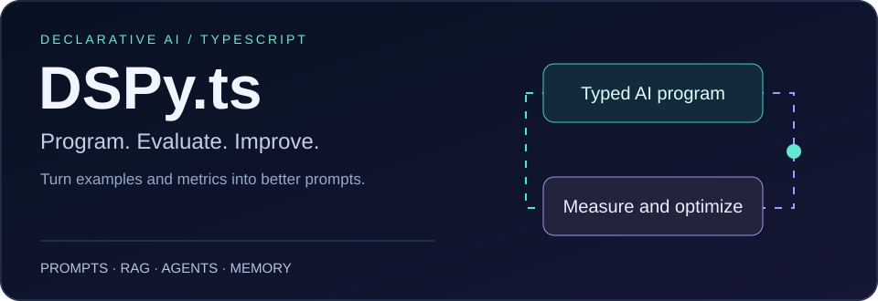
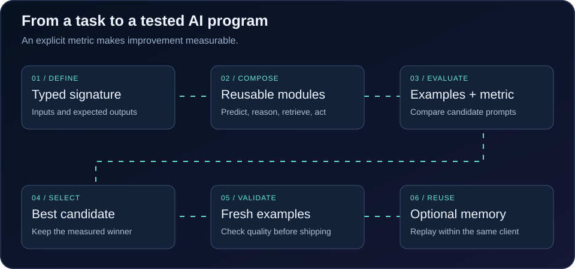

<div align="center">

[](https://www.npmjs.com/package/dspy.ts)
[](https://www.npmjs.com/package/dspy.ts)
[](https://github.com/ruvnet/dspy.ts/actions)
[](https://www.typescriptlang.org/)
[](https://opensource.org/licenses/MIT)
[](https://github.com/ruvnet/dspy.ts)
[](https://www.npmjs.com/package/agentdb)

# DSPy.ts: TypeScript LLM Framework for Prompt Optimization

**Program AI systems, don't prompt them — in TypeScript, on AgentDB.**

</div>



DSPy.ts is a **TypeScript framework for LLM applications and automatic prompt optimization**, inspired by [DSPy](https://github.com/stanfordnlp/dspy). Define typed inputs and outputs, compose reusable modules, and evaluate prompt candidates against your metric. Build retrieval augmented generation (RAG), tool using agents, classification and question answering pipelines in Node.js.

[Quick start](#quick-start) · [Capabilities](#what-you-get) · [Documentation](#documentation) · [Limitations](#roadmap--known-limitations)

### Why DSPy.ts?

Turn repeated prompt editing into a measurable development loop. `BootstrapFewShot`, `MIPROv2` and `GEPA` search instructions or demonstrations using examples and a scoring function. Optional AgentDB integration supports embeddings, retrieval, replay and agent memory. Built by [rUv](https://ruv.io).

### How automatic prompt optimization works



1. Define a task with a typed signature and compose modules.
2. Supply training examples and a metric that represents success.
3. Compile candidate prompts or demonstrations and compare their scores.
4. Evaluate the selected program on separate held out examples before deployment.

### Practical applications

| Application | Building blocks | Measure success |
| --- | --- | --- |
| Support ticket classification | Predict + labeled examples + optimizer | Accuracy and cost per ticket |
| Answers grounded in documents | RetrieveModule + ChainOfThought | Answer correctness and retrieval relevance |
| Tool using assistants | ReAct + optional reflexion memory | Task completion and tool errors |
| Repeated workflow improvement | MIPROv2 replay or GEPA frontier | Quality on fresh examples across compilations |

**Memory scope:** the current `AgentDBClient` stores vectors and metadata in process memory and uses exact cosine scanning by default. Reuse the same client to share experience between compilations. Durable vector persistence and native HNSW indexing are not implemented by this wrapper. Optional sign codes narrow candidates for approximate retrieval; they do not replace the original vectors. Browser compatibility depends on the selected modules and dependencies.

> **New to DSPy?** You don't have to touch AgentDB. Define a `signature`, wrap it in `ChainOfThought`, hand a `metric` + a few examples to `BootstrapFewShot`, call `compile()`. Everything else (vector store, caching, reflexion) is opt-in.

---

## Quick Start

```bash
npm install dspy.ts
```

```ts
import {
  ChainOfThought, BootstrapFewShot, MIPROv2,
  configureLM, DummyLM,           // swap DummyLM for OpenAI / Anthropic / ONNX / torch
} from 'dspy.ts';

configureLM(new DummyLM());       // or your provider

// 1. Declare a typed signature
const qa = new ChainOfThought<{ question: string }, { answer: string }>({
  name: 'QA',
  signature: {
    inputs:  [{ name: 'question', type: 'string', required: true }],
    outputs: [{ name: 'answer',   type: 'string', required: true }],
  },
});

// 2. Optimize it against a metric + a handful of examples
const metric = (_in: { question: string }, out: { answer: string }, gold?: { answer: string }) =>
  gold && out.answer?.trim() === gold.answer ? 1 : out.answer ? 0.3 : 0;

const trainset = [
  { input: { question: 'capital of France?' }, output: { answer: 'Paris' } },
  { input: { question: '2 + 2?' },             output: { answer: '4' } },
  { input: { question: 'largest planet?' } },              // unlabeled → bootstrapped demo
];

const compiled = await new BootstrapFewShot(metric).compile(qa, trainset);
const { answer } = await compiled.run({ question: 'capital of Italy?' });
```

### RAG in three lines — `Retrieve → ChainOfThought`

```ts
import { AgentDBClient, RetrieveModule } from 'dspy.ts';

const store = new AgentDBClient({ vectorDimension: 384, storage: { inMemory: true } });
await store.init();
await store.storeText('Paris is the capital of France.');
await store.storeText('Rome is the capital of Italy.');

const retrieve = new RetrieveModule({ client: store, k: 3, useMMR: true });   // MMR-diversified
const { passages, context } = await retrieve.run({ query: 'what is the capital of Italy?' });
// feed `context` into a ChainOfThought("question, context -> answer")
```

### Learning across compilations with MIPROv2 experience replay

```ts
import { MIPROv2, CompilationTracer } from 'dspy.ts';

const replay = new AgentDBClient({ vectorDimension: 64, storage: { inMemory: true } });
await replay.init();
const tracer = new CompilationTracer({ store: replay });   // causal-chain observability

const opt = new MIPROv2(metric, { numTrials: 12, replayStore: replay, tracer });
await opt.compile(qa, trainset);
// a later compile of the same task fingerprint warm-starts from the prior best instruction:
//   opt2.result.warmStarted === true
```

---

## What you get

| | Capability | Why it matters |
|---|---|---|
| 🧩 | **Composable, typed modules** | `Predict`, `ChainOfThought`, `ReAct`, `Retrieve`, `Pipeline` — declare a signature once, get end-to-end TypeScript types on inputs and outputs. |
| 🎯 | **Self-optimizing** | `BootstrapFewShot`, `MIPROv2`, `GEPA` — hand them a metric + examples; they tune instructions and demonstrations and hand back an `OptimizedModule`. Deterministic per `seed`; `save()`/`load()`. |
| 🧬 | **GEPA prompt evolution** | Genetic-Pareto: a per-example-scored Pareto frontier of prompt candidates, reflect-on-weakest → mutate → admit-if-non-dominated. The frontier is stored in the supplied client and subsequent compilations can warm-start while that client retains it. |
| ♻️ | **Experience replay** | MIPROv2 stores winning instructions by task fingerprint in the supplied replay client for reuse in later compilations. |
| 🔎 | **Input-conditioned few-shot** | `BootstrapFewShot` can pick, *per input at run time*, the demos nearest the current input (vector search) instead of a fixed set. |
| 📚 | **RAG, built-in** | `RetrieveModule` over the AgentDB vector store with Maximal-Marginal-Relevance diversity re-rank → declarative `Retrieve → ChainOfThought` pipelines. |
| 🪞 | **ReAct reflexion** | `ReActReflexion` over AgentDB: recall lessons from failed past attempts before acting, record episodes after, and promote a tool sub-strategy to a *skill* once it succeeds repeatedly. |
| 💾 | **AgentDB memory** | `AgentDBClient`: in-memory cosine search, optional sign-code candidate filtering, hierarchical tiers (`working`/`short`/`long`) and AgentDB embeddings when available. |
| ⚡ | **Fuzzy LM cache** | `CachingLM` wraps any `LMDriver` and serves `generate()` from an AgentDB vector cache — a near-identical prompt is a hit (cosine ≥ threshold, options + TTL aware). |
| 📈 | **Observability** | `CompilationTracer` records optimizer runs + trials as a causal chain (`causedBy` per trial), stored in the supplied client; optional `@mlflow/tracking` logging when that dep is present. |
| 🔌 | **Multi-provider LM** | OpenAI, Anthropic, local ONNX, js-pytorch — `configureLM(driver)`, or compose `CachingLM` around any of them. |

<details>
<summary><strong>Modules</strong></summary>

| Module | What it does |
|--------|--------------|
| `PredictModule` | Single-step typed prediction — format a prompt from the signature, call the LM, parse the structured output. |
| `ChainOfThought` | Step-by-step reasoning before the answer. |
| `ReAct` | Reasoning + Acting: alternates thoughts and tool calls until a final answer. Optional `reflexion` config (see `ReActReflexion`). |
| `ReActReflexion` | Episodic memory for `ReAct` — `recall(taskKey)` lessons + skill plans, `recordEpisode(...)`, promote repeated successful tool sequences to skills. AgentDB-backed. |
| `RetrieveModule` | Vector retrieval over an `AgentDBClient` with MMR diversity; returns `{ passages, context }` for downstream modules. |
| `Pipeline` | Compose modules into a multi-step program with per-step timing and error capture. |

</details>

<details>
<summary><strong>Optimizers</strong></summary>

| Optimizer | What it does |
|-----------|--------------|
| `BootstrapFewShot` | Labeled demos from the trainset + bootstrapped demos (run the program, keep what scores ≥ `minScore`). Optional `dynamicDemos: { store, k }` for input-conditioned demo selection at run time. |
| `MIPROv2` | Instruction proposal (LM + template set + the program's own prompt) → demo bootstrapping → seeded search over (instruction × demo-subset) scored on a trainset minibatch → best `OptimizedModule`. `result` exposes the full trial trace. Optional `replayStore` (cross-run warm-start) and `tracer`. |
| `GEPA` | Genetic-Pareto reflective prompt evolution — per-example Pareto frontier, reflect on a candidate's weakest examples → mutate → evaluate → admit if non-dominated → prune. `result` exposes `best` / `frontier` / `reflections`. Optional `frontierStore` (persist + warm-start). |
| `Optimizer` (base) | `compile(program, trainset)` + `save()` / `load()` — extend it for your own search. |

</details>

<details>
<summary><strong>AgentDB memory layer</strong></summary>

`AgentDBClient` is the substrate the rest of DSPy.ts builds on:

- **Vector store** — `store` / `storeText` / `search` / `searchText` / `update` / `delete` / `batchStore` / `getStats`, with `k` / `minScore` / `includeVectors`, a search cache, and stats. Backed by `agentdb`'s `EnhancedEmbeddingService` (transformers.js / ONNX) for text → vector; `embed()` throws if embeddings are unavailable; `hashEmbed()` is an explicit deterministic alternative, not a semantic embedding.
- **RaBitQ quantization** — `performance.quantization: 'rabitq'` stores a 1-bit-per-dimension sign code (codes alone are ~32× smaller than float32; original vectors are retained); search becomes a Hamming coarse-filter → cosine re-rank of the top `rerankFactor × k`. `quantizationInfo()` reports the mode and compression ratio.
- **Hierarchical tiers** — `store(v, m, { tier })` (`working` | `short` | `long`, default `long`), `searchTiered({ tiers })`, `promote(id, tier)`, `evictTier(tier, { maxAgeMs, max })`, `tierCounts()`.
- **`ReasoningBank` + `SAFLA`** — knowledge units learned from experiences, embedded via the AgentDB EmbeddingService; `retrieveSemantic(queryText, …)` does real vector search over stored units; SAFLA prunes/evolves the knowledge base.

> Some integrations (`agentdb.ReflexionMemory` / `SkillLibrary` / `CausalMemoryGraph`) are currently layered on the `AgentDBClient` vector store with the same behaviour — delegating to those classes directly needs a sql.js `db` handle that `AgentDBClient` doesn't yet expose. Tracked on the issues below.

</details>

<details>
<summary><strong>Examples</strong></summary>

`examples/` includes runnable demos — classification, chain-of-thought, ReAct (incl. a tool agent), fine-tuning, optimization, sentiment, MIPROv2, GEPA (`examples/gepa/`), and AgentDB-backed retrieval (`examples/retrieve/`). Run with `npx ts-node examples/<dir>/index.ts`.

</details>

---

## Documentation

| Doc | Where |
|-----|-------|
| **API reference** | `npm run docs` → `docs/api/` (TypeDoc) — also built in CI. |
| **Examples** | [`examples/`](./examples/) |
| **Migration notes** | [`MIGRATION.md`](./MIGRATION.md) · [`IMPLEMENTATION_SUMMARY.md`](./IMPLEMENTATION_SUMMARY.md) |
| **Changelog** | [`CHANGELOG.md`](./CHANGELOG.md) |
| **Issues / roadmap** | [github.com/ruvnet/dspy.ts/issues](https://github.com/ruvnet/dspy.ts/issues) |

## Roadmap & known limitations

DSPy.ts is moving fast; current honest gaps (tracked on the issues):

- ONNX `generate()` returns a shape summary, not full text — needs a real tokenizer + autoregressive decode loop.
- `agentdb.HNSWIndex` is pattern-table-backed (not a generic KNN store), so `AgentDBClient`'s search is currently a JS cosine scan — wiring `agentdb.WASMVectorSearch` (or a ReasoningBank-style table) would speed it up.
- Delegate ReAct reflexion / skills / compilation traces to `agentdb.ReflexionMemory` / `SkillLibrary` / `CausalMemoryGraph` directly once `AgentDBClient` exposes a `db` handle.
- Consolidate the two LM registries (`src/lm/base` vs the package root).
- A Bayesian surrogate over MIPROv2's search grid; a surrogate-guided / true multi-objective Pareto sampler for GEPA.
- Broader test coverage (`agent/swarm`, `lm/providers`, `modules/chain-of-thought` are still light); the CI coverage gate is informational for now.
- Dependency audit findings need review before a production release; this README does not imply a security certification.

## License

MIT — [rUv / ruvnet](https://github.com/ruvnet)
